# CloudPort System Architecture & Technical Specifications

> **Project:** CloudPort &bull; GDG on Campus BPPIMT Cloud Workshop  
> **Lead Engineer & Architect:** Aaryan Kumar  
> **Status:** Production-Ready  
> **Runtime:** Python 3.11 / 3.12 &bull; Google Cloud Functions (2nd Generation)  

---

## 1. Executive Summary & Objective

**CloudPort** is a production-grade, highly available, serverless event registration platform engineered for the **GDG on Campus BPPIMT Cloud Workshop**. It demonstrates modern Google Cloud Platform (GCP) architectural best practices:

1. **Client-Side:** Pure vanilla HTML5, CSS3, and JavaScript hosted as a static website on **Google Cloud Storage (GCS)**, eliminating server patching and idle compute costs.
2. **Serverless Compute:** An HTTP-triggered **Google Cloud Function (2nd Generation)** powered by Cloud Run and Knative, offering sub-second horizontal auto-scaling and concurrent execution.
3. **Database Layer:** **Google Cloud Firestore in Native mode**, providing globally distributed, high-throughput NoSQL document storage with ACID guarantees.
4. **Decoupled Messaging:** An asynchronous **Cloud Pub/Sub** event stream that triggers worker functions (such as confirmation emails via SendGrid) without blocking the client's HTTP request-response cycle.
5. **Least-Privilege Security:** Fine-grained IAM Service Accounts utilizing **Application Default Credentials (ADC)** with zero hardcoded credentials, complemented by anti-spam honeypot detection and deterministic SHA-256 idempotency.

---

## 2. High-Level Architecture Diagram

```mermaid
flowchart TD
    subgraph ClientBrowser ["Client Web Browser"]
        U["Attendee / Visitor"]
        UI["Vanilla JS Single Page App<br/>(Validation, Fetch API, State Handling)"]
        U -->|Browses| UI
    end

    subgraph StaticHosting ["Google Cloud Storage (Static Website)"]
        Bucket[("gs://[project-id]-cloudport-site<br/>(Public ObjectViewer)")]
        Files["index.html<br/>style.css<br/>script.js<br/>config.js"]
        Bucket --- Files
    end

    subgraph BackendAPI ["Cloud Functions 2nd Gen (Cloud Run Engine)"]
        CF_Reg["cloudport-register<br/>(Python 3.11 / 3.12 Runtime)<br/>Service Account: cloudport-register-sa"]
        CORS["CORS Handler &<br/>OPTIONS Preflight (3600s cache)"]
        Val["Schema Validator &<br/>Honeypot Detector"]
        CF_Reg --> CORS
        CORS --> Val
    end

    subgraph DatabaseLayer ["Cloud Firestore (Native Mode)"]
        FS[("Firestore Database: (default)<br/>Location: asia-south1")]
        Col[("Collection: registrations<br/>Doc ID: SHA256(email)")]
        FS --- Col
    end

    subgraph AsyncPipeline ["Decoupled Event Processing (Bonus)"]
        PS["Pub/Sub Topic:<br/>registration-created"]
        CF_Email["cloudport-send-confirmation<br/>(Eventarc Pub/Sub Trigger)"]
        SM["Secret Manager:<br/>cloudport-sendgrid-api-key"]
        SendGrid["SendGrid Email API"]
        
        PS -->|Pushes message| CF_Email
        CF_Email -->|Accesses token| SM
        CF_Email -->|Sends confirmation| SendGrid
        SendGrid -->|Delivers email| U
    end

    subgraph Observability ["Cloud Operations Suite"]
        CL["Cloud Logging<br/>(Structured JSON Logs)"]
        CM["Cloud Monitoring<br/>(Alerts on 5xx & Errors)"]
    end

    %% Client Interactions
    UI -.->|1. Downloads static assets| Bucket
    UI ==>|2. POST JSON form payload via Fetch API| CF_Reg

    %% Compute Interactions
    Val -->|3. Writes record with SERVER_TIMESTAMP| Col
    Val -->|4. Publishes event payload (Async)| PS
    CF_Reg -.->|5. Emits structured logs| CL
    CL -.->|6. Triggers alert policies| CM
    CF_Reg ==>|7. Returns HTTP 201 Created JSON| UI
```

---

## 3. Request-Response Lifecycle Sequence

The following sequence diagram tracks an attendee registration from initial preflight validation through database persistence and asynchronous event emission:

```mermaid
sequenceDiagram
    autonumber
    actor Attendee as Attendee Browser
    participant CDN as Cloud Storage (GCS)
    participant CF as Cloud Function (cloudport-register)
    participant DB as Cloud Firestore (registrations)
    participant PS as Cloud Pub/Sub (registration-created)
    participant Worker as Email Worker (cloudport-send-confirmation)

    Note over Attendee,CDN: Initial Page Load
    Attendee->>CDN: GET /index.html, style.css, script.js
    CDN-->>Attendee: 200 OK (Static Assets Cached)

    Note over Attendee,CF: CORS Handshake (Preflight)
    Attendee->>CF: OPTIONS /register_user (Origin, Content-Type)
    CF-->>Attendee: 204 No Content (Access-Control-Allow-Origin, Allow-Methods)

    Note over Attendee,CF: Form Submission
    Attendee->>CF: POST /register_user {name, email, department, interest, website}
    
    rect rgb(20, 30, 45)
        Note over CF: Server-Side Processing
        CF->>CF: 1. Origin verification against ALLOWED_ORIGINS
        CF->>CF: 2. Check honeypot (website == "")
        CF->>CF: 3. Validate field constraints & email regex
        CF->>CF: 4. Compute deterministic Doc ID: SHA256(email)
    end

    alt Already Registered (Conflict)
        CF->>DB: create(doc_id, payload)
        DB-->>CF: google.api_core.exceptions.AlreadyExists
        CF-->>Attendee: HTTP 409 Conflict {"ok": false, "error": "This email is already registered"}
    else Valid New Registration
        CF->>DB: create(doc_id, payload + SERVER_TIMESTAMP)
        DB-->>CF: Write Acknowledged
        
        opt Async Pub/Sub Notification
            CF-)PS: publish(registration_event)
            PS-)Worker: trigger(send_confirmation)
        end

        CF-->>Attendee: HTTP 201 Created {"ok": true, "id": doc_id, "message": "..."}
        Note over Attendee: Client renders Ticket Modal & stores ID
    end
```



---

## 4. Component Deep Dive

### 4.1 Frontend Client (`frontend/`)
- **Technology Stack:** Semantic HTML5, Vanilla CSS3 (custom CSS custom properties, zero CSS framework bloat), and modular Vanilla JavaScript (ES6+).
- **Hosting Strategy:** Hosted in a Google Cloud Storage bucket with `website` configuration enabled (`main_page_suffix = "index.html"`, `not_found_page = "index.html"`). All objects are given public read access (`roles/storage.objectViewer` to `allUsers`).
- **Dynamic Configuration:** Decoupled from hardcoded endpoints using `frontend/config.js` (`window.CLOUDPORT_CONFIG = { ENDPOINT: "..." }`) and supported by a runtime `localStorage` override modal for local or preview testing.
- **Client Validation & Accessibility:**
  - Semantic `<label for="...">` linking and ARIA attributes (`aria-required`, `aria-describedby`, `role="alert"`).
  - Immediate visual feedback on field blur and input events.
  - Interactive submit button state: disables during network transit and displays a spinning CSS loader to prevent accidental duplicate clicks.
  - Honeypot protection: An invisible field (`website`) traps automated spam scrapers. Genuine users never interact with it.

### 4.2 Backend Cloud Function (`backend/main.py`)
- **Runtime Environment:** Python 3.11 / 3.12 using Google Cloud Functions 2nd Generation (built atop Google Cloud Run).
- **HTTP Routing & CORS:**
  - Explicit handling for HTTP `OPTIONS` requests returning `204 No Content`, caching preflight checks for 3600 seconds (`Access-Control-Max-Age`).
  - Validates `Origin` header against `ALLOWED_ORIGINS` (comma-separated list, supporting `*` or specific origins like `https://storage.googleapis.com`).
  - Enforces `POST` method (rejecting others with `405 Method Not Allowed`) and `application/json` content type (rejecting non-JSON with `415 Unsupported Media Type`).
- **Validation Engine (`backend/validate.py`):**
  - Sanitizes and normalizes inputs (strips whitespace, forces lowercase email).
  - Enforces field length limits: `name` (2–100 chars), `email` (up to 254 chars with RFC 5322 regex disallowing double dots).
  - Strict whitelist checks against pre-approved academic departments (`DEPARTMENTS`) and workshop focus areas (`INTERESTS`).
- **Data Persistence:**
  - Computes a deterministic 32-character hexadecimal SHA-256 hash from the user's normalized email address.
  - Uses Firestore `document(doc_id).create(...)`. If the document already exists, Firestore raises `google.api_core.exceptions.AlreadyExists`, allowing the function to return a clean `409 Conflict` and prevent duplicate attendee records.
  - Attaches `firestore.SERVER_TIMESTAMP` so creation timestamps reflect exact Google server clocks, immune to client clock drift.
- **Error Obfuscation & Logging:**
  - Catches database or internal exceptions, logs structured JSON payloads with severity level `ERROR` to stdout for Cloud Logging ingestion, and returns a sanitized generic error message to the client (`500 Internal Server Error`). Internal database details, schemas, or stack traces are never exposed.

### 4.3 Database: Cloud Firestore Native (`(default)`)
- **Mode:** Native mode (not Datastore mode), offering rich real-time capabilities and native document collection hierarchies.
- **Data Collection:** `registrations`
- **Schema Definition:**
  ```json
  {
    "name": "string (2-100 characters)",
    "email": "string (lowercase, validated email)",
    "department": "string (CSE | IT | ECE | EE | ME | CE | BCA | MCA | MBA | Other)",
    "interest": "string (Cloud Infrastructure | Serverless | DevOps | Web Development | Mobile Development | Cybersecurity)",
    "createdAt": "Timestamp (server-generated UTC)",
    "source": "string (web_cloudport)"
  }
  ```

---

## 5. Security & Least-Privilege IAM Matrix

CloudPort implements zero-trust principles. No service account keys, passwords, or secrets are committed to version control or baked into container images. All services authenticate through Google Cloud runtime service accounts and Application Default Credentials (ADC).

| Principal (Identity) | Role Name | Resource Target | Justification / Purpose |
|---|---|---|---|
| **Public Users** (`allUsers`) | `roles/storage.objectViewer` | Website Bucket (`gs://[project]-cloudport-site`) | Allows visitors to download static web assets (`index.html`, `style.css`, etc.). |
| **Public Users** (`allUsers`) | `roles/cloudfunctions.invoker` | Registration Function (`cloudport-register`) | Allows anonymous workshop attendees to submit the registration form. |
| **`cloudport-register-sa`** | `roles/datastore.user` | Project Firestore Database | Enables the function to read/write attendee documents in `registrations`. |
| **`cloudport-register-sa`** | `roles/pubsub.publisher` | Topic `registration-created` | Enables publishing asynchronous registration events for downstream workers. |
| **`cloudport-confirm-sa`** | `roles/secretmanager.secretAccessor` | Secret `cloudport-sendgrid-api-key` | Allows the email worker to fetch the SendGrid API key securely at runtime. |
| **`cloudport-confirm-sa`** | `roles/eventarc.eventReceiver` | Project / Region | Allows Eventarc to route Pub/Sub messages to the Cloud Run trigger. |
| **`cloudport-confirm-sa`** | `roles/run.invoker` | Cloud Run Service `cloudport-send-confirmation` | Allows Eventarc to invoke the confirmation email function. |

---

## 6. Observability & Reliability Architecture

CloudPort incorporates continuous monitoring and alerting:

1. **Structured Cloud Logging:**
   All function logs are output as JSON strings containing `severity`, `message`, and contextual metadata (`id`, `email`, `error`). Google Cloud Logging automatically extracts these fields, enabling targeted log queries:
   ```sql
   resource.type="cloud_run_revision"
   resource.labels.service_name="cloudport-register"
   severity>=ERROR
   ```

2. **Log-Based Metrics:**
   A custom metric (`cloudport_function_errors`) tracks error counts across revisions.

3. **Cloud Monitoring Alert Policies:**
   - **5xx HTTP Errors:** Alerts when the registration function returns any `5xx` status code over a 5-minute rolling window.
   - **Error Logs:** Alerts on unhandled exceptions in the application layer.

---

## 7. Cost & Free Tier Optimization

CloudPort is engineered to run at **$0.00 / month** under Google Cloud's permanent Free Tier allocations:

| GCP Service | Free Tier Monthly Allowance | CloudPort Expected Utilization | Est. Cost |
|---|---|---|---|
| **Cloud Storage** | 5 GB standard storage, 50,000 Class B read requests | ~10 MB static assets, ~5,000 views | $0.00 |
| **Cloud Functions (2nd Gen)** | 2 million invocations, 400,000 GB-seconds compute | ~500–2,000 invocations | $0.00 |
| **Cloud Firestore** | 1 GB storage, 50,000 reads/day, 20,000 writes/day | < 500 documents (~100 KB total) | $0.00 |
| **Cloud Pub/Sub** | 10 GB messages / month | < 5 MB message volume | $0.00 |
| **Cloud Logging / Monitoring** | 50 GB log ingestion / month | < 50 MB log volume | $0.00 |
